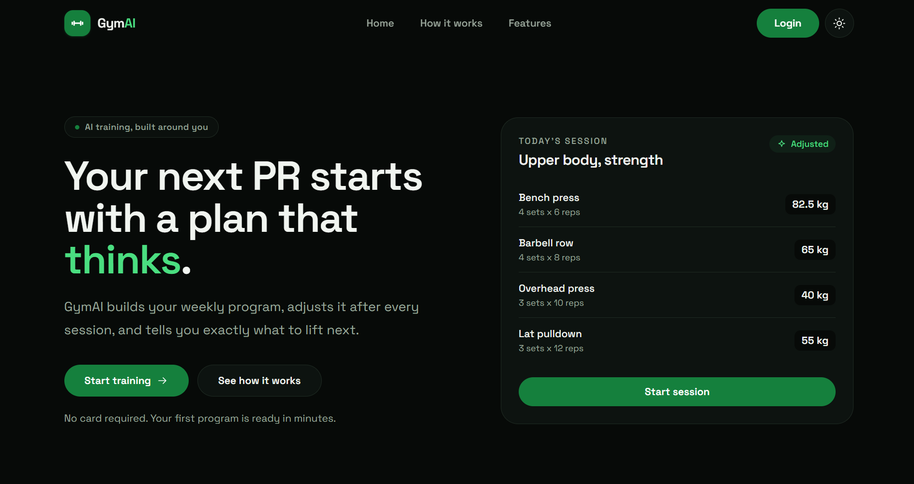

# GymAI

**Training plans that think.** GymAI turns your goal, schedule, equipment, and limitations into a complete weekly training plan with warm-ups, exercises, loads, and progression notes, then exports it as a PDF.



## Features

- **AI-built weekly plans** generated from your goal, experience level, training days, session length, equipment, age, bodyweight, and injury notes.
- **Complete sessions** with warm-ups, 4 to 7 exercises (sets, reps, load, rest), cooldowns, and a weekly progression theme.
- **PDF export** of the generated plan, paginated and ready to take to the gym.
- **Accounts** with hashed passwords, JWT sessions, and MongoDB persistence.
- **Protected routes**: `/start-session` and plan generation require a signed-in user, and the login flow returns you to the page you were trying to reach.
- **Light and dark themes** with a responsive, glass-morphism interface.
- **Toast notifications** for success and error feedback.

## Tech stack

| Layer      | Choice                                                        |
| ---------- | ------------------------------------------------------------- |
| Framework  | Next.js 16 (App Router, Turbopack, Cache Components)          |
| UI         | React 19, TypeScript, Tailwind CSS 4                          |
| Database   | MongoDB with Mongoose 9                                        |
| Auth       | `jose` (HS256 JWT in an httpOnly cookie), `bcryptjs` hashing  |
| AI         | Google Gemini (`generateContent` with a JSON response schema) |
| Export     | `jsPDF` + `html2canvas-pro`                                    |

## Getting started

### Requirements

- Node.js 20.9 or newer
- A MongoDB database (local or MongoDB Atlas)
- A Gemini API key from [Google AI Studio](https://aistudio.google.com/apikey)

### Setup

```bash
cd gym-ai
bun install        # or: npm install

cp .env.example .env.local
```

Fill in `.env.local`:

```env
GEMINI_API_KEY=your-gemini-key
MONGO_URI=mongodb://127.0.0.1:27017/gymai
AUTH_SECRET=replace-with-a-long-random-value
```

Generate a strong `AUTH_SECRET`:

```bash
node -e "console.log(require('crypto').randomBytes(32).toString('hex'))"
```

Start the development server:

```bash
bun dev            # or: npm run dev
```

Open [http://localhost:3000](http://localhost:3000).

## Environment variables

| Variable                | Required | Description                                                                                            |
| ----------------------- | :------: | ------------------------------------------------------------------------------------------------------ |
| `GEMINI_API_KEY`        |   Yes    | Key used by `/api/generate-plan` to call Gemini.                                                       |
| `MONGO_URI`             |   Yes    | MongoDB connection string, for example `mongodb://127.0.0.1:27017/gymai` or an Atlas SRV URL.           |
| `AUTH_SECRET`           |   Yes    | Secret used to sign session JWTs. Keep it stable across deploys, or every session is invalidated.       |
| `GEMINI_MODEL`          |    No    | Primary model. Defaults to `gemini-3.6-flash`.                                                         |
| `GEMINI_MODEL_FALLBACKS`|    No    | Comma separated models retried in order on 404, 429, 502, or 503. Defaults to `gemini-3.5-flash,gemini-3.8-flash`. |

The app reads `.env.local` in development. Set the same values in your hosting provider for production.

## Scripts

| Command      | Description                          |
| ------------ | ------------------------------------ |
| `bun dev`    | Start the dev server with Turbopack. |
| `bun build`  | Production build.                    |
| `bun start`  | Serve the production build.          |
| `bun lint`   | Run ESLint.                          |

`npm run <script>` works the same way if you prefer npm.

## How it works

1. A signed-out visitor who opens `/start-session` is redirected to `/login?next=%2Fstart-session` by the proxy.
2. After registering or logging in, the browser navigates back to the requested page.
3. The visitor fills in their goal, experience, schedule, equipment, and body details, then submits the form.
4. `POST /api/generate-plan` builds a prompt, asks Gemini for structured JSON, normalizes and clamps the response, and returns a plan.
5. The plan renders as a weekly view and can be downloaded as a PDF.

## Project structure

```
gym-ai/
├─ app/
│  ├─ api/
│  │  ├─ auth/
│  │  │  ├─ login/route.ts      # Verify credentials, set session cookie
│  │  │  ├─ logout/route.ts     # Clear session cookie
│  │  │  ├─ me/route.ts         # Current user for the navbar
│  │  │  └─ register/route.ts   # Create an account
│  │  └─ generate-plan/route.ts # Gemini plan generation
│  ├─ login/                    # Login page and form
│  ├─ register/                 # Registration page and form
│  ├─ start-session/            # Intake form, plan view, PDF trigger
│  ├─ layout.tsx                # Root layout, theme bootstrap, toasts
│  └─ page.tsx                  # Landing page
├─ components/                  # Navbar, forms, buttons, toast, theme toggle
├─ lib/
│  ├─ auth/                     # Session, password, validation, roles
│  ├─ models/user.ts            # Mongoose user schema
│  ├─ plan.ts                   # Plan types, options, response normalizer
│  ├─ pdf.ts                    # Client-side PDF export
│  └─ mongo.ts                  # Cached MongoDB connection
├─ public/                      # Static assets, including the screenshot
├─ proxy.ts                     # Route protection and auth redirects
└─ next.config.ts
```

## API

| Route                  | Method | Auth | Description                                                                 |
| ---------------------- | :----: | :--: | --------------------------------------------------------------------------- |
| `/api/auth/register`   |  POST  |  No  | Create an account. Returns `201` with field level validation errors on `400`. |
| `/api/auth/login`      |  POST  |  No  | Verify credentials and set the `gymai_session` cookie.                      |
| `/api/auth/logout`     |  POST  |  No  | Clear the session cookie.                                                   |
| `/api/auth/me`         |  GET   | Yes  | Return the signed-in user's name and email.                                 |
| `/api/generate-plan`   |  POST  | Yes  | Generate a weekly plan from the intake form. Returns `401` when signed out. |

## How authentication works

- Passwords are hashed with bcrypt (10 salt rounds) and never returned by queries (`passwordHash` uses `select: false`).
- On login, the server signs an HS256 JWT with `AUTH_SECRET` containing the user id, email, and name. It is stored in the `gymai_session` cookie: httpOnly, `SameSite=Lax`, 7 day lifetime, and `Secure` in production.
- `proxy.ts` runs on `/start-session`, `/api/generate-plan`, `/login`, and `/register`:
  - Signed-in users visiting `/login` or `/register` are redirected to their `next` destination, defaulting to `/start-session`.
  - Signed-out users visiting a protected page are redirected to `/login?next=<path>`.
  - Protected API routes return JSON `401` responses instead of redirects.
- The `next` parameter is sanitized so only same-origin paths are allowed.

After a successful login the form performs a full page navigation to `next`, which ensures the new session cookie is honored and avoids stale client-side route data.

## Plan options

| Option          | Values                                                                 |
| --------------- | ---------------------------------------------------------------------- |
| Goal            | Build muscle, get stronger, lose fat, general fitness, endurance       |
| Experience      | Beginner, intermediate, advanced                                       |
| Days per week   | 2 to 6                                                                 |
| Session length  | 30, 45, 60, 75, or 90 minutes                                          |
| Equipment       | Commercial gym, dumbbells at home, barbell and rack, bodyweight only   |
| Age             | 13 to 90                                                               |
| Bodyweight      | Optional, in kg or lb                                                  |
| Notes           | Injuries, limitations, or preferences, up to 800 characters            |

All request values are validated and clamped on the server before they reach the model, and the model's response is normalized again before it is returned to the client.

## Deployment

1. Create a MongoDB Atlas cluster and copy its connection string into `MONGO_URI`.
2. Deploy to Vercel (or any Node host) and add `GEMINI_API_KEY`, `MONGO_URI`, `AUTH_SECRET`, and any optional model settings.
3. Keep `AUTH_SECRET` identical across deployments so existing sessions stay valid.
4. Use HTTPS in production, since the session cookie is marked `Secure` there.

## Notes

- Generated plans are training suggestions, not medical advice. Consult a qualified coach or clinician when returning from an injury.
- The project does not include automated tests at this time.

## License

No license has been added to this project yet.
